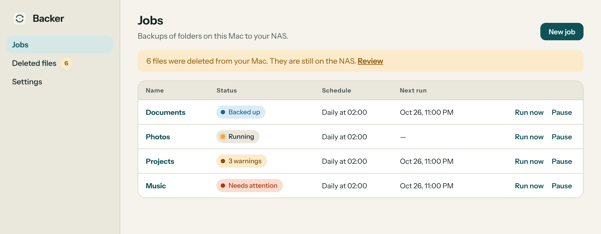
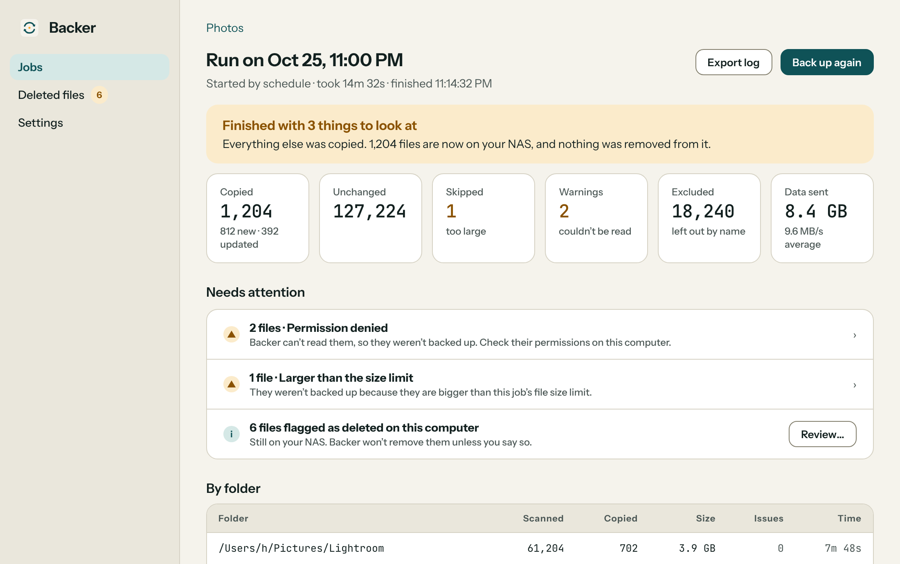

# Backer

**Back up your folders to a NAS on a schedule, and never delete anything on it without asking.**

[](https://github.com/howardcrow3/Backer/actions/workflows/ci.yml)
[](https://github.com/howardcrow3/Backer/releases/latest)


Backer is a desktop app for macOS and Windows. You pick the folders, pick a folder on your NAS, and choose when it should run. A small background service does the rest, even when the window is closed. Your backups are ordinary files in the same folder layout, so you can browse and restore them with Finder or File Explorer.

<p align="center">
  <picture>
    <source media="(prefers-color-scheme: dark)" srcset="docs/images/jobs-dark.png">
    
  </picture>
</p>

<p align="center"><sub>Screenshots use sample data.</sub></p>

## Features

- **Backs up to a NAS share.** Any share your operating system can mount as a folder (SMB or NFS) works. Developed against a Synology NAS.
- **Flexible schedules.** Run on demand, every few hours, daily, or on chosen weekdays. If the computer was asleep or off at the scheduled time, Backer can catch up at the next opportunity.
- **Built for big folders.** Designed for well over 100,000 files. Each run compares size and modification time and copies only what changed.
- **Safe copies.** Each file is written to a temporary file next to its destination, checked with a BLAKE3 checksum, then renamed into place. Leftovers from an interrupted run are cleaned up.
- **Never deletes without asking.** Files you delete on your computer stay on the NAS and appear under **Deleted files**. Backer removes one from the NAS only after you select it and confirm.
- **Won't write to the wrong place.** A marker file in the NAS folder proves the share is really mounted, so an unmounted NAS can't fill your local disk.
- **Clear run summaries.** Every run records what was copied, skipped or couldn't be read, with per-folder numbers, problems grouped by cause, and a searchable file log you can export as CSV.
- **Options.** Skip files above a size limit. Junk such as `.DS_Store` and `Thumbs.db` is left out automatically.
- **Lives in the tray.** Closing the window keeps backups running. The tray (menu bar) icon opens the app, runs all jobs, or quits and stops backups after asking.
- **Works with AI assistants.** An optional local [MCP](#connecting-an-ai-assistant-mcp) server lets an assistant you approve check on jobs and start them.
- **Private.** No account, no cloud service. The app and the service talk to each other only on your computer, and fonts are bundled.

<p align="center">
  <picture>
    <source media="(prefers-color-scheme: dark)" srcset="docs/images/run-dark.png">
    
  </picture>
</p>

## Supported systems

| System | Supported | Notes |
|---|---|---|
| macOS | 13 or later, Apple silicon | `.dmg`. Ad hoc signed, not notarized. The service starts at login as a LaunchAgent. |
| Windows | 10 and 11, 64-bit | Unsigned installer. The service starts at login as a scheduled task. |
| Intel Mac, Linux | Not packaged | The core crates build and are tested on Linux in CI. |

## Download

<!-- latest-build:start -->
**Latest build: [v0.4.0](https://github.com/howardcrow3/Backer/releases/tag/v0.4.0)** (2026-10-27)

| Platform | Download |
|---|---|
| macOS, Apple silicon | [Backer_0.4.0_aarch64.dmg](https://github.com/howardcrow3/Backer/releases/download/v0.4.0/Backer_0.4.0_aarch64.dmg) |
| Windows 10/11, 64-bit | [Backer_0.4.0_x64-setup.exe](https://github.com/howardcrow3/Backer/releases/download/v0.4.0/Backer_0.4.0_x64-setup.exe) |

The Mac build is ad hoc signed, not notarized: right-click the app, choose Open, then Open again. The Windows installer is unsigned: if SmartScreen warns, choose More info, then Run anyway. Older builds are on the [releases page](https://github.com/howardcrow3/Backer/releases).
<!-- latest-build:end -->

## Getting started

1. **Mount your NAS share.** On a Mac, use Finder, Go, Connect to Server. On Windows, map the share to a drive letter or open `\\nas\share` in File Explorer.
2. **Open Backer and choose New job.** Pick the folders to back up, the folder on the NAS, a schedule and any options, then review. Backer places a small marker file, `.backer-destination`, in the NAS folder.
3. **Let it run.** The first run copies everything. Later runs copy only what changed. Open a job, then a run, to see how it went.

Each backed-up folder lands under the NAS folder you chose, with the same structure as on your computer. Changed files replace the earlier copy on the NAS. Backer doesn't keep version history yet.

## Connecting an AI assistant (MCP)

Assistants launch `backer-agent mcp-bridge` (Settings, "Connect an assistant" shows the exact JSON). The bridge only copies JSON-RPC lines between stdio and the service. The service identifies the program that launched the bridge (macOS: its code-signing requirement) and answers only after you allow it in the app.

An approved assistant has twelve tools: `list_jobs`, `get_job`, `list_runs`, `get_run_summary`, `get_run_log`, `test_connection`, `run_job`, `set_schedule`, `pause_job`, `resume_job`, `delete_job` (it must give the job's exact name, and NAS files are never touched) and `create_job` (it only asks you to set one up; you choose the folders, NAS and times). It cannot delete files from the NAS or choose folders or destinations. `crates/backer-agent/tests/bridge_e2e.rs` runs a real service and a real bridge end to end.

## Build from source

You need the [Rust toolchain](https://rustup.rs). On a Mac, also run `xcode-select --install`.

```sh
cargo test --workspace && ./scripts/check-crate-graph.sh   # the core crates, on any OS
cargo build --release -p backer-agent
cd app/src-tauri && cargo install tauri-cli --version "^2" --locked
cargo tauri icon ../icon-source.png                        # generates the platform icons, once
cargo tauri build                                          # produces the .app and .dmg (or the Windows installer)
```

Copy `target/release/backer-agent` next to the app binary (`Contents/MacOS/` on a Mac) so the app can install it as the background service. CI builds both installers on every push; see `.github/workflows/ci.yml`.

## Project layout

| Path | What |
|---|---|
| `crates/backer-core` | shared types, job validation |
| `crates/backer-store` | SQLite state: jobs, runs, run logs, file records, the deleted-files list |
| `crates/backer-connector` | destination access; `Connector` has no delete; `Eraser` is separate |
| `crates/backer-engine` | scan, diff, copy (temp file, verify, atomic rename), flag missing files |
| `crates/backer-removal` | the only code that can delete from the NAS, and only reviewed files |
| `crates/backer-sched` | schedule maths, DST-safe, catch-up after sleep |
| `crates/backer-mcp` | MCP server logic; cannot depend on engine, removal or store |
| `crates/backer-agent` | background service: scheduler, local sockets, approvals, login start-up |
| `app/` | Tauri 2 tray app and UI (built separately from the workspace; CI builds it for macOS and Windows) |

## Platform notes

- **Windows.** The service listens on loopback TCP with a random token kept in `%LOCALAPPDATA%\Backer`. Windows can't tell which program is on a local port, so MCP approval there is one shared "unverified" identity.
- **Design.** The UI follows the Backer design language: light and dark colour tokens, Instrument Sans and JetBrains Mono, and the "Refresh" icon (two looping arrows on a paper tile with an amber status dot). Tokens are at the top of `app/ui/style.css`, and fonts are bundled in `app/ui/fonts` (SIL OFL). Status colours are blue (success), amber (warnings) and vermilion (failed), never green and red.

## Status and roadmap

Backer is early software. Backing up, scheduling, the deleted-files review, run summaries and the tray work on macOS and Windows.

Not built yet: an SFTP connector, browse-and-restore inside the app, version history, code signing and notarization, an Intel Mac build, and a log file for the service itself.
